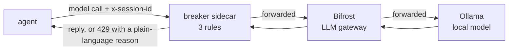

# agent-circuit-breaker

A runnable demo of **circuit breakers for AI agents at the LLM gateway**. Companion to the blog post
*The Agent That Never Stopped: Circuit Breakers at the LLM Gateway*.

A deliberately broken on-call agent keeps calling a log-search tool that always times out.
Run it once with no rules and watch it burn calls and tokens until its own `max_iterations`
finally stops it. Run it again with three gateway rules on and watch the breaker trip in a
fraction of the time.

Everything runs locally with Docker. The model is a small one served by Ollama, so it costs nothing.



## What is in here

| Path | What it is |
|---|---|
| `docker-compose.yml` | Ollama (model), Bifrost (gateway), breaker (rules), agent (the thing that loops) |
| `bifrost/config.json` | Bifrost config: one Ollama provider, file-only mode |
| `breaker/breaker.py` | ~200 lines, stdlib only. The three rules, half-open recovery, alerts as JSON log lines |
| `agent/agent.py` | The broken agent. Tool-calling loop, `search_logs` always times out, stubborn nudge back to the tool |
| `rules/*.json` | `none`, `all`, and one file per rule so you can turn them on individually |
| `Makefile` | `make demo` and friends |

## Run it

Needs Docker. First run downloads the Ollama image (about 8.6 GB, it bundles GPU libraries) and the model (about 1 GB), so give it time and disk.

```bash
make demo
```

That does four things:

1. Starts Ollama, Bifrost and the breaker.
2. Pulls the model (`qwen2.5:1.5b` by default).
3. **Run 1, rules off.** The agent loops until its own `max_iterations` (30) stops it. You see every call and the final count.
4. **Run 2, rules on.** Same agent, same model, `rules/all.json` active. You see which rule tripped, after how many calls, and the message the agent received.

The last lines of `make demo` are the breaker's `TRIP` and `ALERT` log entries for the second run.

Measured on a laptop (CPU only, so about 40 s per call), with the full logs in [RESULTS.md](RESULTS.md):

| | calls | tokens | wall time | stopped by |
|---|---|---|---|---|
| Run 1, rules off | 30 | 36,860 | 21.6 min | agent `max_iterations` |
| Run 2, rules on | 9 | 4,415 | 10.8 min | repeat rule, at call 9 |

## The three rules

All three are keyed on the `x-session-id` header the agent sends with every call. Without that header the breaker has nothing to count against and passes the call through (it logs `no_session_id` so you notice).

**Rule 1, budget per task.** Two counters per session: tokens and calls. Either one crossing its cap trips the breaker. If the call carries `x-parent-session-id`, both counters also roll up into the parent, so a task cannot dodge its budget by splitting into sub-agents.

**Rule 2, rate cap per session.** Calls per session in a sliding window. A healthy agent waits on tools and models; a looping one fires back to back. On a CPU-only laptop each call takes 40 s, so this rule never fires in the demo as shipped (12 calls / 60 s is sized for a hosted API). Try `"max_calls": 4, "window_seconds": 240` to see it trip locally.

**Rule 3, repeat detection.** The breaker reads the `tool_calls` the model asks for in each response and hashes tool name plus (sorted) arguments. The same hash N times in a row inside the window trips it on the next request. Note this is *not* a hash of the request body. The request body carries the whole conversation and grows every turn, so it never repeats.

When a rule trips, the agent gets HTTP 429 with a body like:

```json
{"error": {"type": "circuit_breaker_tripped", "rule": "repeat",
  "message": "The exact same tool call (search_logs {\"minutes\": 10, \"service\": \"checkout-api\"}) has been requested 3 times in a row and is being refused. The tool is probably failing. Try a different approach or stop and report.",
  "session_id": "with-rules-1a2b3c4d"}}
```

and the breaker logs a `TRIP` line and an `ALERT` line carrying the session id, the rule, and the last five tool calls. In a real deployment the `ALERT` line is what you route to Slack or PagerDuty.

**Half-open.** After `half_open_after_seconds` the breaker lets one probe call through. If the model asks for the same tool call that tripped it, the breaker reopens for good. Otherwise it closes. The demo agent stops on the first refusal, so to see half-open in action write an agent that waits and retries, or poke the breaker with `curl`.

## Rules file

`rules/all.json`:

```json
{
  "budget": { "max_tokens": 20000, "max_calls": 25 },
  "rate":   { "max_calls": 12, "window_seconds": 60 },
  "repeat": { "max_identical": 3, "window_seconds": 600 },
  "half_open_after_seconds": 30
}
```

Set any rule to `null` to turn it off. The breaker re-reads the file on every request, so you can edit it while the agent is running.

## Experiments

```bash
make run-rule RULE=repeat     # one rule at a time: budget | rate | repeat | none | all
make run-rule RULE=budget
MAX_ITERATIONS=60 make run-without-rules      # let it run longer, watch the token curve
MODEL=qwen2.5:3b make demo                    # a bigger model, does it break out of the loop by itself?
make state                                    # per-session counters and breaker state
make logs                                     # follow the breaker's JSON log
```

Things worth trying:

- **Lower `max_identical` to 2** in `rules/all.json`. How much earlier does it trip?
- **Make the tool fail differently each time.** In `agent/agent.py`, add a counter to the timeout message. Repeat detection goes quiet because the model's next request changes. Which rule catches it now, and how much later?
- **Turn `max_iterations` off** (`MAX_ITERATIONS=100000 make run-with-rules`). The gateway still stops it. That is the whole argument of the post.
- **Swap the model.** A larger model may notice the identical failures and stop on its own. Smaller, cheaper models, the ones teams reach for in high-volume agent work, usually do not.
- **Sub-agents.** Run two agents with the same `PARENT_SESSION_ID` and watch the parent budget trip before either child's own budget does:
  ```bash
  RULES=budget docker compose up -d --force-recreate --no-deps breaker
  PARENT_SESSION_ID=job-1 RUN_NAME=child-a docker compose run --rm --no-deps -e PARENT_SESSION_ID=job-1 agent &
  PARENT_SESSION_ID=job-1 RUN_NAME=child-b docker compose run --rm --no-deps -e PARENT_SESSION_ID=job-1 agent
  ```

## Why a sidecar and not a Bifrost plugin?

Bifrost's governance can rate-limit and budget per virtual key, team or customer, and its plugin
interface can read headers and body and short-circuit a request. Both are the right tools in production.
But custom Bifrost plugins are Go `.so` files that need a dynamically built binary, which is more than a
laptop demo should ask of you, and the built-in limits are not keyed on a per-request session header.
So the rules live in a ~200-line sidecar *in front of* the gateway. It is in the request path, which is the
only property that matters. The same logic ports to a LiteLLM custom guardrail, a Portkey guardrail, a Kong
plugin, or a Bifrost Go plugin.

## Watching it in Langfuse (optional)

Bifrost ships an OpenTelemetry plugin that can send traces to Langfuse. If you have a Langfuse
project (cloud or self-hosted), add this to `bifrost/config.json` and restart Bifrost:

```json
"plugins": [{
  "enabled": true, "name": "otel",
  "config": {
    "service_name": "bifrost-demo",
    "collector_url": "https://cloud.langfuse.com/api/public/otel/v1/traces",
    "trace_type": "genai_extension", "protocol": "http",
    "headers": { "Authorization": "env.LANGFUSE_BASIC_AUTH" }
  }
}]
```

with `LANGFUSE_BASIC_AUTH="Basic <base64(public_key:secret_key)>"` in Bifrost's environment.
Then run the demo again and compare: Langfuse shows every call of the loop in detail. The breaker is the one that stopped it.

## Clean up

```bash
make down      # stop containers, keep the downloaded model
make clean     # stop and delete the model volume too
```

## Licence

MIT.
